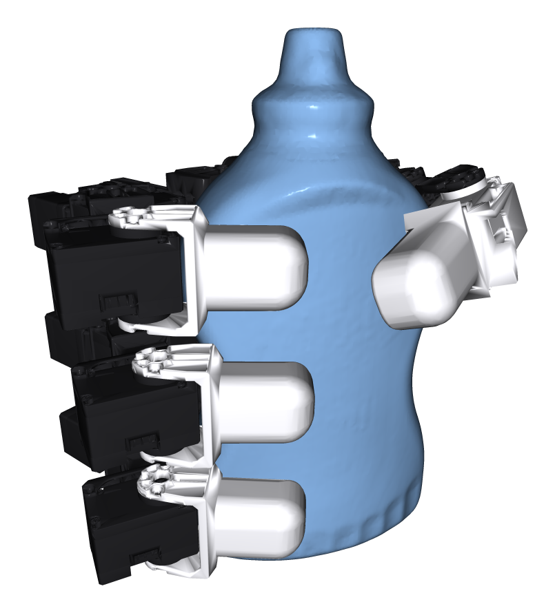
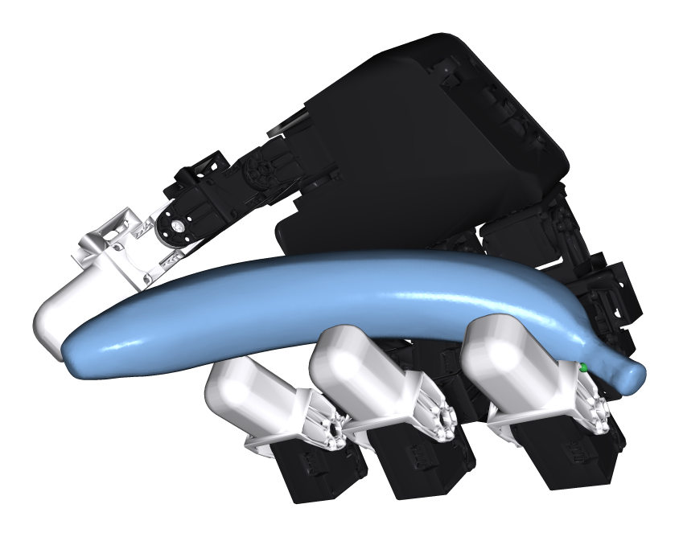
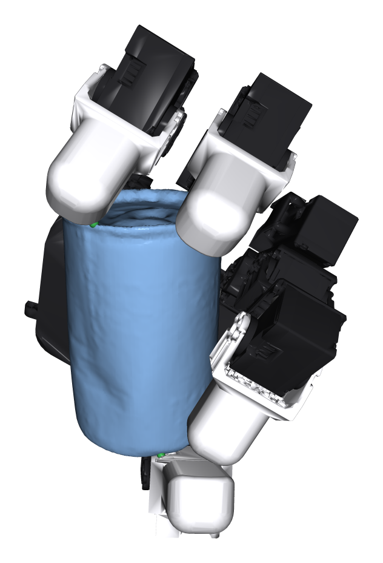
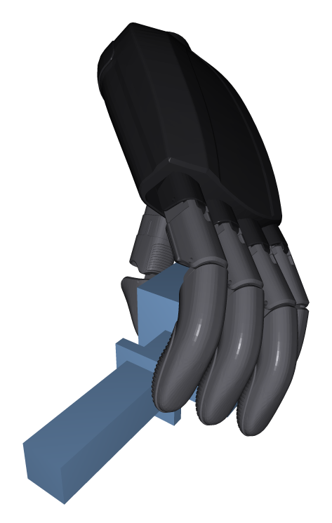
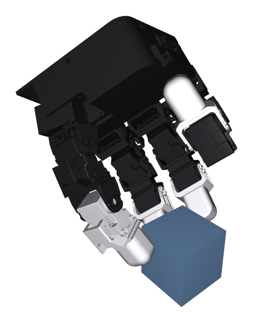
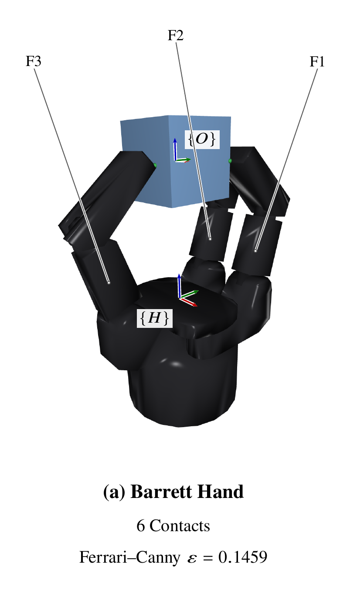
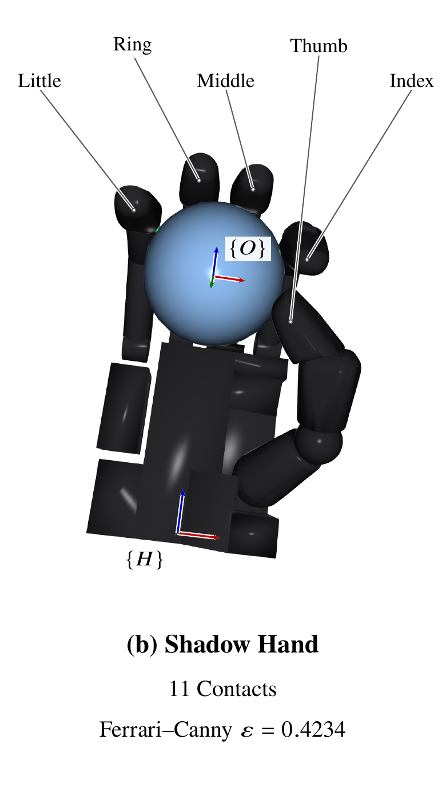
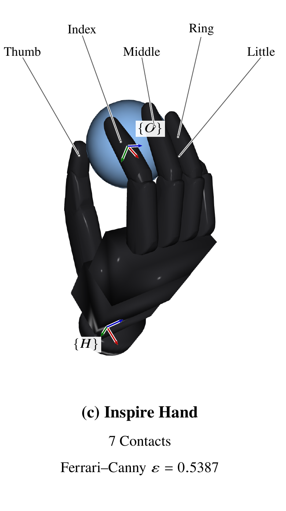
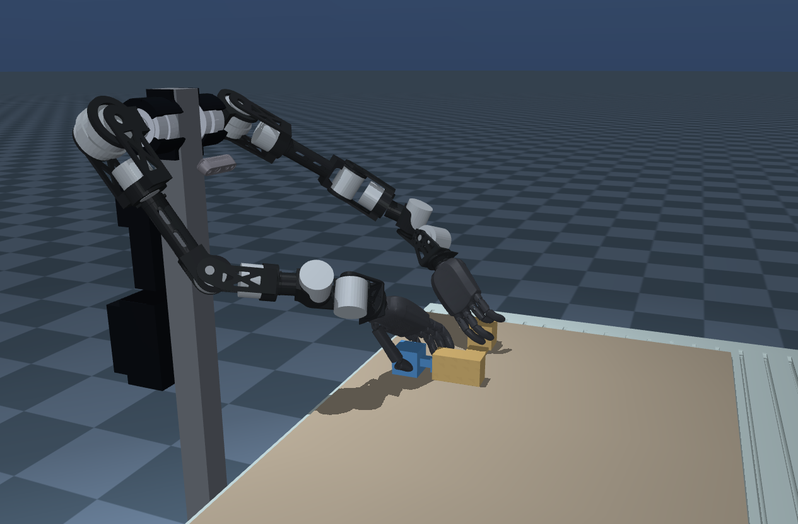
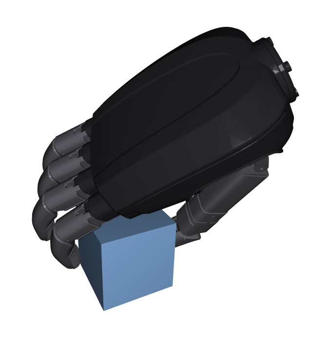

# graspit-py

[](LICENSE)
[](setup.py)
[](https://clintonenwerem.com/graspit-py/)
[](https://huggingface.co/datasets/cenwerem/graspit-py-household)
[](https://arxiv.org/abs/2611.29011)

`graspit-py` exposes the [GraspIt! simulator](https://graspit-simulator.github.io/)
as a Python library for multifingered grasp synthesis, contact analysis, and
grasp-dataset generation. Researchers can close a hand on an object, evaluate
its contacts under pose and friction uncertainty, and carry the resulting
configurations and quality samples into numerical or learning workflows.

- **Native bindings:** set hand poses and joint coordinates, close fingers with autograsp, query collisions and contact geometry, and evaluate wrench-space metrics.
- **Contact planner:** search approach commands and rank closures by Ferrari–Canny quality or task-wrench capacity under pose and friction uncertainty.
- **Learning data:** export named hand coordinates, object-frame poses and contacts, point clouds, and sampled quality labels to versioned NPZ archives for NumPy or PyTorch.
- **MuJoCo exporter:** generate GraspIt! hand and object descriptions from a compiled MuJoCo scene, with a joint map for reconstructing planned configurations.

Contact positions, normals, and sampled scores remain available to caller-defined
numerical routines. The calling application supplies arm kinematics, trajectory
planning, and execution. See the [manual](https://clintonenwerem.com/graspit-py/)
for the mathematical formulation, API, and complete workflows.

## Installation

The native extension targets Linux. The reference environment uses Ubuntu 24.04
and Python 3.12; the package requires Python 3.10 or later. Docker supplies the
Linux environment, pinned GraspIt! engine, and dependencies for the commands below.

```sh
git clone https://github.com/coenwerem/graspit-py.git
cd graspit-py
docker buildx build --load -f docker/Dockerfile -t graspit-py .
docker run --rm graspit-py python -m graspit_py.planning --help
```

The final command prints the planner usage beginning with:

```text
usage: python -m graspit_py.planning [-h] --robot ROBOT --object OBJECT
```

The [installation guide](https://clintonenwerem.com/graspit-py/INSTALL.html)
covers native builds, optional dependencies, and headless execution.
Python imports use `graspit_py`; existing `graspit_python_wrapper` imports
remain supported, as described in the guide.

## First Grasp

The image includes the native Barrett hand and a 50 mm cube, so this closure
example requires no external model assets. Xvfb supplies the virtual display
used by GraspIt! during headless execution.

```sh
mkdir -p output
docker run --rm --user "$(id -u):$(id -g)" \
    -v "$PWD/output:/output" graspit-py \
    xvfb-run -a python /src/examples/contact_quality.py \
    --robot /opt/graspit/models/robots/Barrett/Barrett.xml \
    --object /opt/graspit/models/objects/cube.xml \
    --object-position-mm 0 0 100 --out /output/barrett-cube.json
```

The command prints contact and quality measurements and writes
`output/barrett-cube.json`. The [walkthrough](https://clintonenwerem.com/graspit-py/quickstart.html)
explains the output and continues with RealHand L6 model export and planning.

## Grasp Planning

For an existing GraspIt! model, supply the robot XML, object XML, and a JSON
configuration defining the hand axes, approach search, and task loads. Run
from the directory containing those files; the mount and working directory
make them available at `/work` inside the container.

```sh
docker run --rm --user "$(id -u):$(id -g)" \
    -v "$PWD:/work" --workdir /work graspit-py \
    xvfb-run -a python -m graspit_py.planning \
    --robot hand.xml --object object.xml \
    --config problem.json --out candidates.json
```

Each grasp record connects an object-relative palm pose and closed joint
coordinates to nominal contacts and sampled wrench scores. The
[planning guide](https://clintonenwerem.com/graspit-py/planning.html) provides
configuration examples and output fields; the
[theory guide](https://clintonenwerem.com/graspit-py/theory.html) defines the
contact mechanics, coordinate conventions, and uncertainty objectives.

## Household Objects and Learning Data

Download the public [Household Grasps dataset](https://huggingface.co/datasets/cenwerem/graspit-py-household)
or browse its `grasps` and `objects` tables in the Hugging Face Dataset Viewer.
The collection is available under CC BY 4.0, with Parquet tables and the complete
NPZ/JSON archives.

The [household-object workflow](examples/household_objects/README.md) connects
grasp synthesis to learning-data preparation. It preserves the physical scale
of a YCB mesh, samples its surface, runs native hand closure, and exports the
resulting configurations and quality labels. The example collection contains
**288 static grasp candidates: 24 for each of six objects on Barrett and LEAP**.
The objects are a sugar box, tomato soup can, mustard bottle, tuna fish can,
banana, and apple. Each record retains the named coordinate order,
object-relative hand pose, contacts, and individual pose/friction quality samples.

| Mustard Bottle | Banana | Tomato Soup Can |
| :---: | :---: | :---: |
|  |  |  |
| 27 contacts; native Ferrari–Canny ε = 0.321 | 9 contacts; native Ferrari–Canny ε = 0.118 | 9 contacts; native Ferrari–Canny ε = 0.412 |

The illustrated LEAP grasps were closed again from their saved commands before
rendering. The labels quantify static contact quality under the native model.

The [dataset guide](https://clintonenwerem.com/graspit-py/datasets.html) defines
the SI coordinate contract, ragged contact/sample arrays, model hashes, and
NumPy/PyTorch loading. Poses and contact positions use meters; independent hand
coordinates use radians. Archives also retain 2,048 object-surface points,
preshapes, closing-coordinate masks, and separate native and recomputed quality
values. These fields support quality prediction, candidate ranking, and
point-cloud-conditioned grasp generation with caller-defined acceptance criteria.

Download the [LEAP mustard-bottle example](https://clintonenwerem.com/graspit-py/datasets.html#household-object-examples)
to read 24 records without a simulator:

```python
from graspit_py.dataset import load_dataset

data = load_dataset("ycb_mustard_bottle.npz").arrays
poses_m = data["T_object_hand_m"]  # (24, 4, 4)
dofs_rad = data["dofs_rad"]       # (24, 16)
points_m = data["object_pointcloud_m"]  # (2048, 3)
```

Loading requires NumPy and the Python standard library; the native GraspIt!
extension is needed for synthesis. A [PyTorch DataLoader example](examples/household_objects/load_torch.py)
shows tensor batching. Keep training and evaluation object identities disjoint
when measuring generalization to unseen objects. Object meshes remain
user-supplied, and the downloadable example includes source attribution.

## Supported Hands and Grasp Examples

The [hand-model guide](https://clintonenwerem.com/graspit-py/hands.html) documents
native Barrett support and MuJoCo export profiles for RealHand L6, LEAP,
PSYONIC Ability, Shadow, and Inspire. It includes model sources, kinematic
profiles, grasp records, and the operations evaluated for each hand.

| RealHand L6 | LEAP Hand | PSYONIC Ability Hand |
| :---: | :---: | :---: |
|  |  |  |
| Planned key grasp | Simulated cube hold | Simulated sphere hold |

The L6 image shows a planned GraspIt! closure; the LEAP and Ability images
show final MuJoCo lift-and-hold configurations.

| Barrett Hand | Shadow Hand | Inspire Hand |
| :---: | :---: | :---: |
|  |  |  |
| 6 contacts, Ferrari–Canny ε = 0.146 | 11 contacts, Ferrari–Canny ε = 0.423 | 7 contacts, Ferrari–Canny ε = 0.539 |

Higher ε indicates greater worst-direction wrench resistance under the modeled
force budget. Comparisons require common object, friction, torque-scaling, and
force-budget conventions. The Shadow image uses visual meshes at the closed
joint configuration; its contacts and quality were computed with collision geometry.

## MuJoCo Model Export

| MuJoCo Source Scene | Exported RealHand L6 in GraspIt! |
| :---: | :---: |
|  |  |

The MuJoCo panel shows a bimanual key-insertion configuration. The GraspIt!
panel shows the exported right hand closed on the key from a second viewpoint.
The [export guide](https://clintonenwerem.com/graspit-py/export.html) explains the
affine joint map, collision representations, configuration reconstruction, and
link-geometry comparisons. The
[visualization roadmap](https://clintonenwerem.com/graspit-py/roadmap.html)
describes the planned standalone viewer for grasp records and model correspondence.

## Citation and References

Cite `graspit-py` using [CITATION.cff](CITATION.cff) and record the software
revision used. The [companion paper](https://arxiv.org/abs/2611.29011)
describes the interface, mathematical formulation, and software evaluation.
Cite the corresponding simulator publication for experiments performed in
GraspIt! or MuJoCo.

- Enwerem, C., Baras, J. S., and Belta, C. (2026). [graspit-py: A Python Interface to GraspIt! for Grasp Planning Under Pose and Friction Uncertainty](https://arxiv.org/abs/2611.29011). arXiv:2611.29011.
- Miller, A. T., and Allen, P. K. (2004). [GraspIt! A Versatile Simulator for Robotic Grasping](https://www.cs.columbia.edu/~allen/PAPERS/graspit.final.pdf). *IEEE Robotics & Automation Magazine*, 11(4), 110–122.
- Todorov, E., Erez, T., and Tassa, Y. (2012). [MuJoCo: A Physics Engine for Model-Based Control](https://doi.org/10.1109/IROS.2012.6386109). *IEEE/RSJ International Conference on Intelligent Robots and Systems*, 5026–5033.

See the [full reference list](https://clintonenwerem.com/graspit-py/references.html)
for contact mechanics, grasp quality, and risk-sensitive planning references.
The software is licensed under [GPL-3.0-or-later](LICENSE).

## Contributing

See [CONTRIBUTING.md](CONTRIBUTING.md) for development setup, issue reports,
and contribution guidelines.
