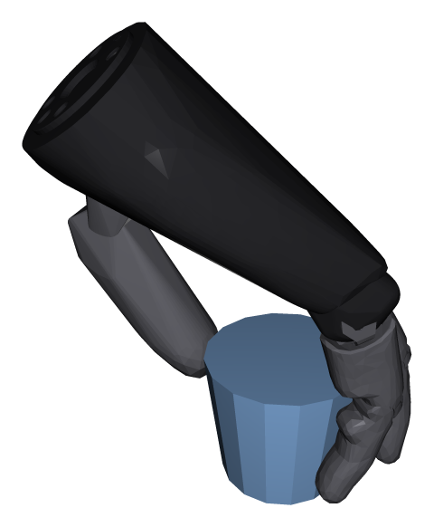

# GraspIt! Python Wrapper

[Documentation](https://clintonenwerem.com/graspit-python-wrapper/) ·
[GraspIt! Simulator](https://graspit-simulator.github.io/) ·
[arXiv Preprint (Coming Soon)](https://clintonenwerem.com/graspit-python-wrapper/references.html#software-preprint)

`graspit_python_wrapper` exposes the [GraspIt! simulator](https://graspit-simulator.github.io/)
as a Python library for grasp synthesis and evaluation with multifingered
hands. The native bindings provide hand pose and joint control, autograsp,
collision queries, contact geometry, and wrench-space metrics. The contact
planner ranks simulated closures by Ferrari–Canny quality or task-wrench
capacity under approach and friction uncertainty. The MuJoCo exporter
generates GraspIt! hand and object descriptions and records the joint
correspondence for transferring a planned configuration back to MuJoCo.

## Installation on Linux

The reference build uses Ubuntu 24.04 and Python 3.12. Docker builds the
pinned public GraspIt! source with the supplied compatibility patch.

```sh
git clone https://github.com/coenwerem/graspit-python-wrapper.git
cd graspit-python-wrapper
docker buildx build --load -f docker/Dockerfile -t graspit-py .
```

The [installation guide](docs/INSTALL.md) also covers native builds
and headless execution.

## Grasp Planning

The [RealHand L6 walkthrough](docs/quickstart.md) uses a user-supplied
MuJoCo model of the right hand and a 50 mm cube. For an existing GraspIt!
model, pass the robot XML, object XML, and a JSON configuration defining
the hand axes, approach search, and any task loads. From the directory
containing those files, run the planner in the Docker image.

```sh
docker run --rm --user "$(id -u):$(id -g)" -v "$PWD:/work" graspit-py \
    xvfb-run -a python -m graspit_python_wrapper.planning \
    --robot hand.xml --object object.xml \
    --config problem.json --out candidates.json
```

Each candidate contains the object-relative palm pose, closed joint
coordinates, object-frame contacts, and sampled wrench scores. The
[theory guide](docs/theory.md) defines those quantities and their
coordinate conventions. The [supported-hands guide](docs/hands.md)
documents native Barrett support and export coverage for the RealHand L6,
LEAP, PSYONIC Ability, Shadow, and Inspire hands. It provides runnable
kinematic profiles and records the operations evaluated for each model. The calling application supplies arm
kinematics, trajectory planning, and execution.

## Planned Grasps and Simulated Execution

| RealHand L6 | LEAP Hand | PSYONIC Ability Hand |
| :---: | :---: | :---: |
|  |  |  |
| Planned key grasp | Simulated cube hold | Simulated sphere hold |

The RealHand L6 image shows the planned GraspIt! closure. The LEAP
and Ability images show final configurations from recorded MuJoCo
lift-and-hold simulations. The [planning guide](docs/planning.md)
reports Ferrari–Canny scores for the RealHand L6 and LEAP grasps.

## MuJoCo Model Export

| MuJoCo Source Workcell | Exported RealHand L6 in GraspIt! |
| :---: | :---: |
|  |  |

The MuJoCo panel shows a recorded bimanual key insertion. The
GraspIt! panel shows the exported right hand closed on the key from
a second viewpoint. The [export guide](docs/export.md) explains how
to reconstruct planned configurations and compare link geometry.

The [visualization roadmap](docs/roadmap.md) specifies the planned standalone
viewer for model correspondence, grasp records, contact normals, and frames.

## Citation and References

Cite the wrapper using [CITATION.cff](CITATION.cff) and record the
software revision used. The wrapper is licensed under
[GPL-3.0-or-later](LICENSE).

- Miller, A. T., and Allen, P. K. (2004). [GraspIt! A Versatile Simulator for Robotic Grasping](https://www.cs.columbia.edu/~allen/PAPERS/graspit.final.pdf). *IEEE Robotics & Automation Magazine*, 11(4), 110–122.
- Ferrari, C., and Canny, J. F. (1992). [Planning Optimal Grasps](https://doi.org/10.1109/ROBOT.1992.219918). *IEEE International Conference on Robotics and Automation*.
- Todorov, E., Erez, T., and Tassa, Y. (2012). [MuJoCo: A Physics Engine for Model-Based Control](https://doi.org/10.1109/IROS.2012.6386109). *IEEE/RSJ International Conference on Intelligent Robots and Systems*.
- Rockafellar, R. T., and Uryasev, S. (2002). [Conditional Value-at-Risk for General Loss Distributions](https://doi.org/10.1016/S0378-4266(02)00271-6). *Journal of Banking & Finance*, 26(7), 1443–1471.
- Enwerem, C., Baras, J. S., and Belta, C. (2026). [FIRMGrasp: A Friction-Informed Risk Margin for Robust Grasp Synthesis](https://arxiv.org/abs/2607.25049). arXiv:2607.25049.

See the [manual references](https://clintonenwerem.com/graspit-python-wrapper/references.html)
for sources on hand posture, frictional contact, and grasp wrench spaces.
